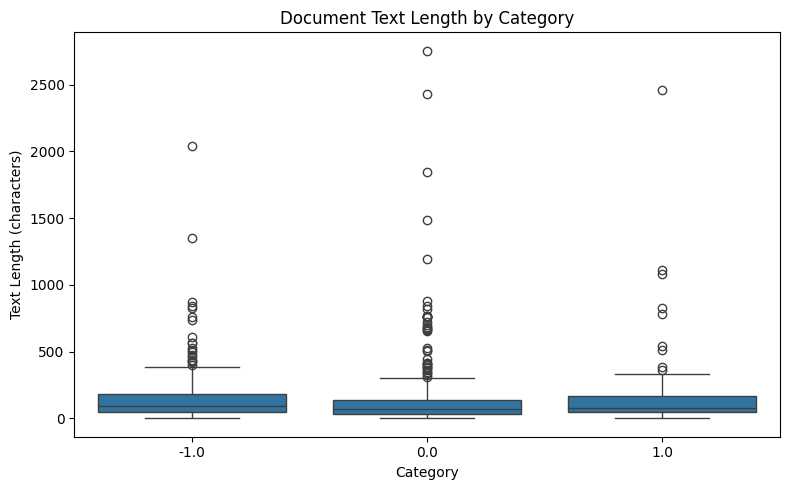

# DM2026 Lab 1 Homework Report

**Student:** 李中信  
**Student ID:** D11409105  
**Dataset:** `newdataset/Reddit-stock-sentiment.csv`

## 1. Dataset and Research Objective

This homework evaluates whether the student-developed data mining tools can generalize from the 20 Newsgroups dataset to Reddit stock sentiment data. Using `load_dataset_tool` (`load_dataset_1`), I loaded 847 Reddit posts or comments, including 315 negative, 423 neutral, and 109 positive documents. Neutral sentiment is the largest category, while positive sentiment is the smallest. This imbalance should be considered when interpreting subsequent results.

## 2. Data Quality and Descriptive Statistics

The missing-value check (`check_missing_2`) identified zero missing documents. The duplicate check (`check_duplicates_3`) found 23 additional duplicate copies, with 34 documents belonging to duplicate groups. I retained the original 847 documents for the subsequent analysis. Descriptive statistics (`describe_data_4`) showed a mean document length of 148.68 characters and a median of 79 characters, indicating that the dataset contains many short comments and some substantially longer posts.

## 3. Text Processing and Document-Term Matrix

Tokenization (`tokenize_5`) produced 26,386 tokens across 847 documents, averaging approximately 31.15 tokens per document. The document-term matrix (`build_dtm_6`) contained 847 rows and 4,346 unigram features, with 17,193 nonzero entries and 99.5329% sparsity. Term-frequency analysis (`term_frequency_7`) showed that common English words such as "the", "to", and "and" dominated the vocabulary. This suggests that stopword handling could be useful in future improvements.

## 4. Feature Selection and Interpretation

Variance filtering at threshold 0.01 retained 506 of 4,346 features (11.64%).

For neutral sentiment, Pearson filtering at threshold 0.01 retained 3,962 features (`pearson_filter_11`), while Spearman filtering retained 3,933 (`spearman_filter_12`). The methods shared 3,895 features, giving a Jaccard similarity of approximately 0.9738.

The correlation-based methods produced highly overlapping feature sets. Variance filtering removed considerably more features, although different selection criteria mean that retention counts alone cannot establish predictive performance.

## 5. Pattern Mining and Conclusion

FP-Growth on neutral sentiment with term-frequency filtering and minimum support 10 (`mine_patterns_tool_13`) returned zero frequent patterns. A later attempt at minimum support 3 was interrupted and produced no verified result.

The workflow successfully processed 847 Reddit documents across three sentiment classes. Tokenization produced 26,386 tokens, and the 847-by-4,346 DTM was 99.53% sparse.

The results demonstrate basic portability of the tools. However, class imbalance, duplicate documents, and the lack of predictive evaluation limit conclusions about sentiment classification. Further experiments could evaluate dimensionality reduction and downstream prediction.
