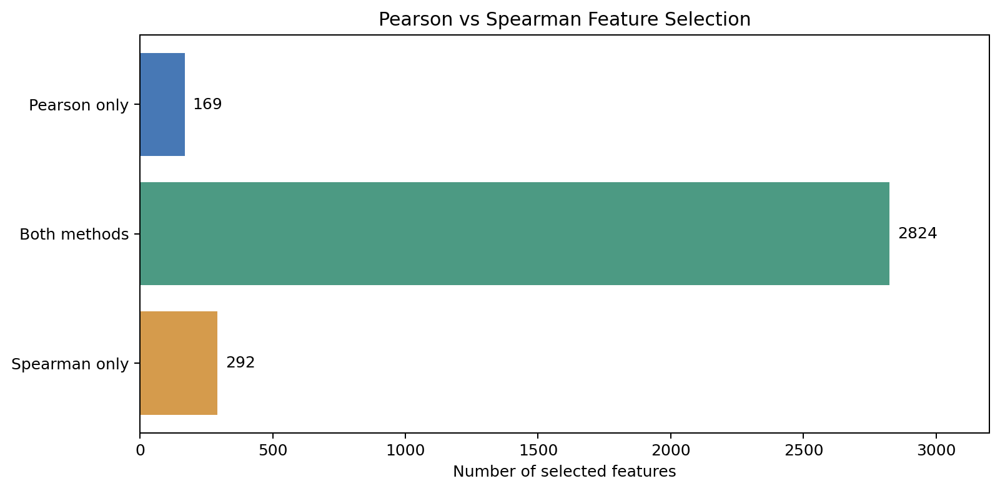

# Agentic Pipeline Analysis Report

**Student:** 李中信 (d11409105)

## 1. Dataset and Initial Inspection

The analysis used 1,079 documents from the 20 Newsgroups
categories `alt.atheism` (480) and
`soc.religion.christian` (599). The dataset was loaded
through the Agent (`load_dataset_2`). Missing-value
inspection found zero missing documents
(`check_missing_3`), and duplicate inspection found
zero duplicate documents (`check_duplicates_4`).

## 2. Text Processing and DTM Construction

Tokenization produced 491,375 tokens
(`tokenize_5`, Gemini Agent). Subsequent direct tool
execution constructed a document-term matrix with
1,079 rows and 19,666 term features (`build_dtm_6`).
Term frequencies were also calculated
(`term_frequency_7`). These preprocessing results
provide the feature representation for analysis.

## 3. Feature Selection

Direct tool execution applied variance filtering
with threshold 0.01 (`variance_filter_8`).
Pearson filtering retained 2,993 of 19,666 features
(`pearson_filter_9`), while Spearman filtering
retained 3,116 (`spearman_filter_10`), using
absolute correlation threshold 0.05 and target
class `soc.religion.christian`.

## 4. Comparison and Interpretation

Pearson and Spearman shared 2,824 selected features.
Pearson uniquely selected 169 features and Spearman
uniquely selected 292. Their Jaccard similarity was
0.8597, indicating substantial overlap. These
results describe feature-selection agreement, not
predictive accuracy. The feature overlap comparison
was calculated separately from the Agent conversation.

**Execution note:** The encrypted Agent logs document
the actual Agent interactions. Later preprocessing
and feature-filtering tools were invoked directly
for verification and must not be interpreted as
additional Agent chat turns.

### Feature Selection Comparison Figure

The figure shows 2,824 features selected by both methods, 169 selected only by Pearson, and 292 selected only by Spearman. It was generated separately from the Agent conversation using the stored results `pearson_filter_9` and `spearman_filter_10`.
